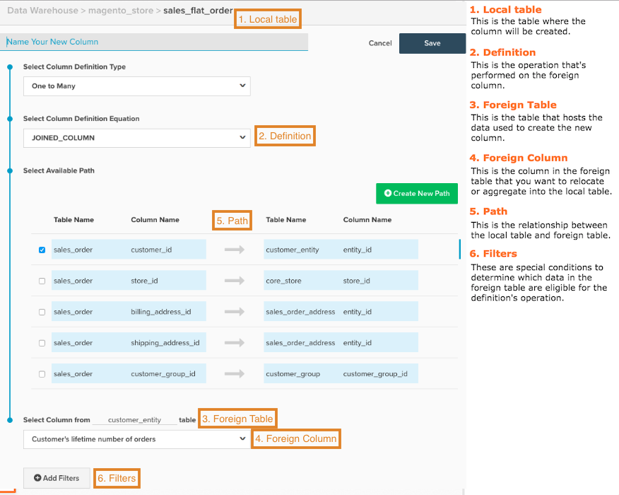

# Crear columnas calculadas

Al analizar los datos, resulta útil consolidar los datos de diferentes fuentes. ¿Desea agrupar los ingresos por origen de adquisición, vinculando los datos de la tabla `orders` y los datos [!DNL Google Analytics]? Tal vez desee agrupar los ingresos por sexo del cliente o unir un atributo del cliente a los datos de transacción para la segmentación. En este tema se explica cómo hacerlo.

Antes de comenzar, Adobe recomienda que revise la [Guía de tipos de columnas calculadas](../../data-analyst/data-warehouse-mgr/calc-column-types.md) para obtener información sobre los tipos de columnas que puede crear en el Administrador de Data Warehouse, junto con sus definiciones y ejemplos.

1. Para empezar, haga clic en **[!DNL Manage Data > Data Warehouse]**.

1. Haga clic en la tabla en la que desea crear una columna. Por ejemplo, si desea crear una columna `Customer Gender` para la segmentación de ingresos, debe seleccionar la tabla `sales_flat_order`.

1. Se muestra el esquema de tabla. Haga clic en **[!UICONTROL Create New Column]**.

1. Asigne un nombre a la columna. Por ejemplo, `Customer Gender`.

1. Seleccione la definición de la columna. ¡Aquí es donde la guía [Tipos de columnas calculadas](../data-warehouse-mgr/calc-column-types.md) resulta útil!

1. Para ciertos tipos de columnas, se necesita un poco más de información para crear correctamente la columna:

   * Para las columnas `One to Many` (unidas) y `Many to One` (agregadas), debe seleccionar las tablas y columnas.

   * Para un(a) `Same Table calculation`, debe seleccionar el campo de fecha deseado en la lista desplegable.

Si está creando una columna `One to Many` (combinada) o `Many to One` (agregada), debe seleccionar una ruta para conectar las dos tablas. En este paso, puede utilizar una ruta de acceso existente o crear una.

>[!NOTE]
>
>Recuerde definir correctamente la tabla como varios o uno.

* Si lo desea, puede aplicar [filtros](../../data-user/reports/ess-manage-data-filters.md) a la nueva columna.

* Cuando termine, haga clic en **[!UICONTROL Save]**.

La nueva columna aparece en la tabla actual con un estado `Pending`. Una vez que se complete la siguiente actualización, la columna estará disponible para usarla en métricas e informes.

## Mapa de referencia útil {#map}

Si tiene problemas para recordar cuáles son todas las entradas al crear una columna calculada, intente mantener este mapa de referencia a mano cuando esté construyendo:

## Documentación relacionada

* [Tipos de columnas calculadas](../data-warehouse-mgr/calc-column-types.md)
* [Tipos de columnas calculadas avanzadas](../data-warehouse-mgr/adv-calc-columns.md)
* [Creando  [!DNL Google ECommerce] dimensiones con datos de pedidos y clientes](../data-warehouse-mgr/bldg-google-ecomm-dim.md)
