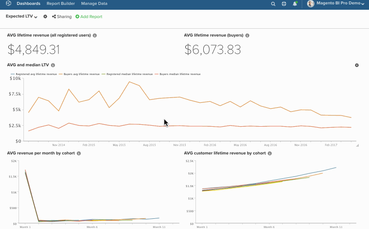
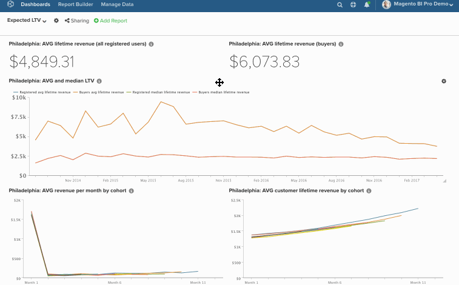

# Edición masiva de gráficos en paneles

La función de edición masiva facilita el cambio de nombres y fechas de gráficos en los paneles. Por ejemplo, desea que todos los gráficos de un tablero específico hagan referencia a un único almacén e informe con periodicidad mensual en lugar de trimestral. En lugar de cambiar todo manualmente, deje que la característica `bulk-editing` haga el trabajo. En este tema, aprenderá a utilizar lo siguiente:

* [Función  [!DNL Find/Replace] &#x200B;](#findreplace)

* [Función  [!DNL Prepend Name] &#x200B;](#prepend)

* [Función  [!DNL Change Dates] &#x200B;](#dates)

Dicho esto, considere esto - *¿Es necesario que estos cambios sean permanentes?* Si no es así, considere la posibilidad de clonar el panel y, a continuación, cambiar las fechas en el nuevo panel. Esto le permite conservar su panel original mientras realiza los cambios que necesita.

>[!NOTE]
>
>Si está cambiando numerosos informes, el proceso de actualización podría tardar un poco.

## Usando [!DNL Find/Replace] {#findreplace}

1. Haga clic en el icono de engranaje () junto al nombre del panel y, a continuación, en la ventana [!UICONTROL Bulk Edit Reports].

1. Haga clic en **[!UICONTROL Chart Title Find and Replace]** en la ventana emergente.

1. En el campo `Chart Title Find`, escriba las palabras o los caracteres que desee buscar.

1. En el campo `Replace With`, escriba las palabras o los caracteres que deben reemplazar lo que se encuentra en el campo `Find`.

1. Haga clic en **[!UICONTROL Update Reports]**.

Ejemplo:

## Anteponiendo `Chart Names` {#prepend}

1. Haga clic en el icono de engranaje () junto al nombre del panel y, a continuación, en la ventana [!UICONTROL Bulk Edit Reports].

1. Haga clic en **[!UICONTROL Prepend Report Names]** en la ventana emergente.

1. Escriba las palabras o los caracteres que desea anteponer a los gráficos.

1. Haga clic en **[!UICONTROL Update Reports]**.

Ejemplo:

## Cambiando `Dates` {#dates}

1. Haga clic en el icono de engranaje () junto al nombre del panel y, a continuación, seleccione la ventana [!UICONTROL Bulk Edit Reports].

1. Haga clic en **[!UICONTROL Change Dates]** en la ventana emergente.

1. Establecer los nuevos `Start/End Date` y `Time Interval`. También puede dejar estos campos sin cambios.

1. Haga clic en **[!UICONTROL Update Reports]**.

Ejemplo:

