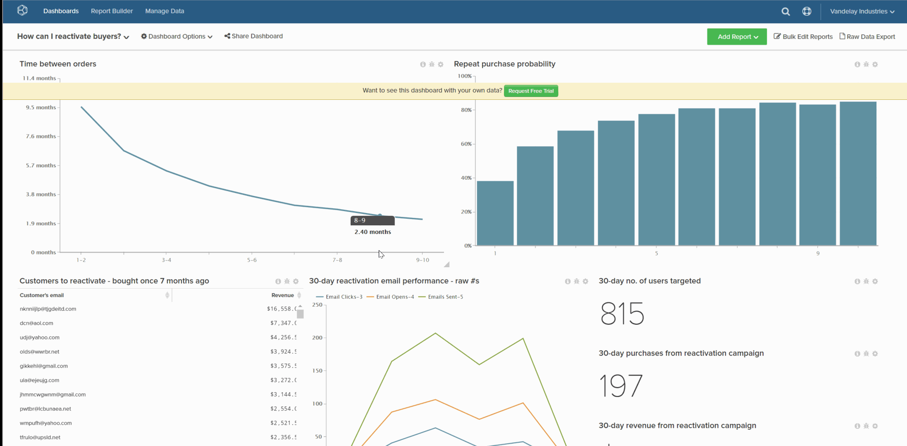

# Establecer un tablero predeterminado

El tablero predeterminado es el primer tablero que ve al abrir [!DNL Commerce Intelligence].

1. En el tablero, haga clic en **[!UICONTROL Dashboard Options]**, que se encuentra en la parte superior de la pantalla.

1. Haga clic en **[!UICONTROL Make Default]** en la lista desplegable.

1. Cuando aparezca el mensaje de confirmación, haga clic en **[!UICONTROL Yes]** para cambiar el panel predeterminado.

Este es ahora su nuevo tablero predeterminado.

Ejemplo:

